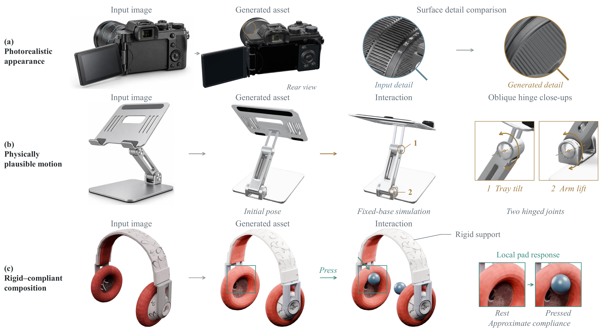

<h1 align="center">PhysAg3D: Bridging 3D Generative and Agentic Models<br>for High-Fidelity and Physically-Interactive Assets</h1>

<p align="center">
  <a href="https://supra-3d.github.io/PhysAg3D/"></a>
  <a href="https://supra-3d.github.io/PhysAg3D/assets/PhysAg3D.pdf"></a>
  <a href="#license"></a>
</p>

<p align="center">
  <a href="https://pkudba.github.io/">Bi'an Du</a><sup>1,2*</sup>,
  <a href="https://mfp0610.github.io/">Fanpeng Meng</a><sup>3*</sup>,
  <a href="https://jaminfong.cn/">Jiemin Fang</a><sup>3‡✉</sup>,
  <a href="https://chensjtu.github.io/">Chen Yang</a><sup>3</sup>,<br>
  Pufan Li<sup>1,2</sup>,
  <a href="https://liudaizong.github.io/">Daizong Liu</a><sup>4</sup>,
  <a href="https://www.qitian1987.com/">Qi Tian</a><sup>2,3✉</sup>,
  <a href="https://www.wict.pku.edu.cn/huwei/">Wei Hu</a><sup>1✉</sup>
</p>

<p align="center">
  <sup>1</sup>Peking University &nbsp;&nbsp;
  <sup>2</sup>Guangdong Laboratory of Artificial Intelligence and Digital Economy (SZ)<br>
  <sup>3</sup>Huawei &nbsp;&nbsp;
  <sup>4</sup>Wuhan University<br>
  <sup>*</sup>Equal contribution &nbsp;&nbsp;
  <sup>‡</sup>Project lead &nbsp;&nbsp;
  <sup>✉</sup>Corresponding authors
</p>

<p align="center">
  <a href="https://supra-3d.github.io/PhysAg3D/">
    
  </a>
</p>

**PhysAg3D** turns a single image into a detailed 3D asset with object-specific
interactions. It combines the appearance and geometry of a pretrained 3D
generator with a vision-language agent that reasons about parts, mechanisms,
and physical behavior. The agent builds and refines the assembly using
geometric and simulation tools while preserving useful generated surfaces,
textures, and materials.

- **Appearance and interaction together.** Retain image-aligned surface detail
  while making the visible parts move with their mechanisms.
- **Rigid and compliant behavior.** Support articulated parts and deformable
  regions through explicit bindings between physical structure and rendered surfaces.
- **Evidence-guided refinement.** Use rendered states and execution measurements
  to locate failures and make targeted revisions within a fixed budget.
- **Inspectable outputs.** Keep the source image, native candidate, authoring
  files, interaction evidence, and delivery report alongside the final asset.

Learn more on the [project page](https://supra-3d.github.io/PhysAg3D/), or read the
[paper](https://supra-3d.github.io/PhysAg3D/assets/PhysAg3D.pdf).

## Method

<p align="center">
  
</p>

1. **Infer and generate.** A vision-language agent proposes semantic parts,
   interactions, and physical priors. A 3D generator produces a textured
   whole-object mesh from the same image.
2. **Construct and bind.** A hierarchical interaction representation connects
   interaction intent, physical structure, and concrete realization. The agent
   constructs parts, joints, and compliant regions, then binds them to the
   generated surfaces.
3. **Observe and refine.** Rendered observations and execution measurements guide
   local repairs. The delivered result records its verified behavior and any
   unresolved requirements.

See the project page for [qualitative comparisons](https://supra-3d.github.io/PhysAg3D/#results)
and [quantitative evaluation](https://supra-3d.github.io/PhysAg3D/#evaluation).

## Repository Contents

The `main` branch provides the preparation and execution tools for the released
agent-assisted workflow:

- [`execute.py`](execute.py): verify the release, check an environment, prepare
  a case, inspect its launch command, and start the worker.
- [`method/`](method/): the worker protocol, TRELLIS.2 client, modeling and
  validation references, declared historical code examples, and viewer tools.
- [`examples/`](examples/): runtime configuration templates for a Windows
  controller with a Linux GPU host, plus an experimental Linux-local setup.
- [`inputs/`](inputs/): example source images.
- [`provenance/`](provenance/) and [`verify_external.py`](verify_external.py):
  recorded runtime/model fingerprints and a utility for comparing a deployment.

The website and its offline demonstration package are maintained separately on
the [`homepage` branch](https://github.com/Supra-3D/PhysAg3D/tree/homepage).
The public gallery lets visitors inspect existing assets in the browser;
generating a new asset requires the environment below.

## Installation

### Prerequisites

The supplied Windows/SSH configuration uses two environments:

- **Controller:** Python 3.11 or later, Blender, a compatible Codex CLI with your
  own ChatGPT login, and an SSH client. The recorded worker workflow uses Blender
  5.2.1. The launcher currently requires `gpt-6-astra` with `high` reasoning effort
  and checks that the CLI supports its required flags.
- **Generation host:** a Linux NVIDIA GPU environment with TRELLIS.2, its native
  dependencies, TRELLIS.2 model weights, DINOv3, and BiRefNet already deployed.
  The example profile requires at least **28 GiB of free GPU memory** before
  submission; actual usage depends on the deployment.

The repository does not bundle these model weights or install the generation
host. Use [`doctor`](#quick-start) to check your configured deployment before
starting a case. The [Linux-local profile](examples/runtime.linux-local.EXPERIMENTAL.json)
is provided as an experimental alternative.

### Set up the controller

Run the following in PowerShell:

```powershell
git clone --branch main --single-branch https://github.com/Supra-3D/PhysAg3D.git
cd PhysAg3D
python -m venv .venv
.\.venv\Scripts\python.exe -m pip install -r requirements.observed.txt
Copy-Item examples/runtime.windows-ssh.json config/runtime.local.json
```

[`requirements.observed.txt`](requirements.observed.txt) records Python package
versions observed in the original controller environment. It is not a complete
clean-install lock and does not set up Blender, Codex, CUDA, or TRELLIS.2.

Edit `config/runtime.local.json` for your machine:

- Set `python` to the absolute path of `.venv/Scripts/python.exe`, and set
  `blender` and `codex` to your installed executables.
- Set `trellis.ssh_host` to your SSH host alias. Configure and verify SSH access
  beforehand; the client requires a known host key and non-interactive login.
- Set `trellis.python`, `runtime`, `model`, `dino`, `rembg`, and `jobs_root` to
  absolute Linux paths on that host. The jobs directory must be writable.
- Keep the native generation settings at resolution `1024`, `24` steps,
  texture size `2048`, and seed `42`; the launcher validates these settings.

This local configuration file is ignored by Git. The launcher uses your own
ChatGPT login and does not accept API credentials in the configuration.

## Quick Start

**1. Verify the release and check the environment.**

```powershell
.\.venv\Scripts\python.exe execute.py verify
.\.venv\Scripts\python.exe execute.py doctor --config config/runtime.local.json --native
```

`verify` checks the declared source files against `checksums.json`. `doctor`
checks controller tools and dependencies; `--native` also checks the generation
host's paths, imports, and GPU inventory. Neither command starts generation.

**2. Prepare a new case from an image.**

```powershell
.\.venv\Scripts\python.exe execute.py prepare --image inputs/fig8_01_4fe3cc6a.png --config config/runtime.local.json --out ../PhysAg3D-runs/example-01
```

Replace `--image` with your own source image. Use a new, empty output directory
**outside the repository** for each case. Preparation copies the input and
method files, records their identities, and assigns a separate native job root.
It does not call a model.

**3. Inspect the launch command, then run.**

```powershell
.\.venv\Scripts\python.exe execute.py plan ../PhysAg3D-runs/example-01
.\.venv\Scripts\python.exe execute.py run ../PhysAg3D-runs/example-01
```

`run` starts the configured agent worker and can submit GPU generation jobs.
The default case budget is three hours, with at most two acceptance passes and
two repair rounds. The launcher rejects changes to prepared inputs/configuration
and does not silently resume or retry an already attempted case.

### Inspect the result

Read the case's `delivery.json` for the actual output paths and completion status.
The delivery contract includes a refined GLB, editable Blender file, MuJoCo scene
and dependencies, motion video, source/native/refined comparisons, and a local
viewer when available. Missing outputs and unresolved behavior are recorded in
the report.

For a delivered viewer at `presentation/index.html`, serve the case directory:

```powershell
.\.venv\Scripts\python.exe -m http.server 8000 --bind 127.0.0.1 --directory ../PhysAg3D-runs/example-01
```

Then open `http://127.0.0.1:8000/presentation/` in a browser. Check
`interaction_status`, `physics_status`, `motion_kind`, and `limitations` in
`delivery.json`: simulated replay, parameterized animation, and static output
represent different outcomes. Successful worker completion alone does not mean
that the asset passed its interaction and physics checks.

## Reproducibility and Validation

The released protocol includes declared historical **code-only** references that
the worker may adapt. It records `strict_isolation=false`; it is an assisted
workflow, not a claim of fully isolated, context-independent inference. Model
access, external runtime versions, and per-case agent decisions affect results.

Run the preparation and public-layout checks without model calls or GPU services:

```powershell
.\.venv\Scripts\python.exe -m unittest discover -s tests -v
```

For implementation details, see the [worker protocol](method/WORKER_PROMPT.md),
[inference operations](method/trellis2-native-refine/references/operations.md),
[refinement workflow](method/trellis2-native-refine/references/workflow.md),
[validation guidance](method/trellis2-native-refine/references/validation.md), and
[compliant assets](method/trellis2-native-refine/references/soft-assets.md).
Source checksums and external fingerprints establish file identity, not visual
quality or physical correctness. A single image also leaves hidden structure,
scale, and material parameters uncertain; the output records these as estimates.

## Acknowledgments

This implementation builds on TRELLIS.2, Blender, MuJoCo, and Three.js. We thank
their authors and the broader 3D generation and simulation communities for
making their tools available. External tools and models retain their respective
licenses; the bundled Three.js license is included in [`licenses/`](licenses/).

## License

Original PhysAg3D source code is released under the [MIT License](LICENSE).
The bundled Three.js code retains its [MIT license and copyright notice](licenses/three-r170-LICENSE.txt).
External tools and model weights retain their respective licenses and are not
covered by the PhysAg3D source-code license.

## Citation

If you find this work useful for your research, please cite:

```bibtex
@misc{du_physag3d,
  title   = {PhysAg3D: Bridging 3D Generative and Agentic Models
             for High-Fidelity and Physically-Interactive Assets},
  author  = {Du, Bi'an and Meng, Fanpeng and Fang, Jiemin and
             Yang, Chen and Li, Pufan and Liu, Daizong and
             Tian, Qi and Hu, Wei},
  note    = {Research manuscript},
  url     = {https://supra-3d.github.io/PhysAg3D/}
}
```
